**Code repository:** <https://github.com/jangde-aboli/MLOPs_assignment_HeartML>

**Demo video:** <link to recording>

# 1. Overview

The goal is a classifier that predicts whether a patient has heart disease from 13 routine
clinical measurements, delivered as a production-style service rather than a notebook.
The pipeline covers:

1. **Data:** a scripted download from the UCI repository, then cleaning and EDA.
2. **Modelling:** three model families compared with tuned hyperparameters, all inside one
   scikit-learn `Pipeline` that also does the preprocessing.
3. **Tracking:** every run is logged to MLflow (parameters, metrics, plots, tuning tables,
   model), and the final model is registered.
4. **CI/CD:** GitHub Actions runs lint → tests → training with a quality gate → Docker build
   and smoke test.
5. **Serving:** a FastAPI service in Docker, deployed to Kubernetes behind a LoadBalancer
   Service and an Ingress.
6. **Monitoring:** structured JSON request logs plus Prometheus metrics, shown on a
   provisioned Grafana dashboard.

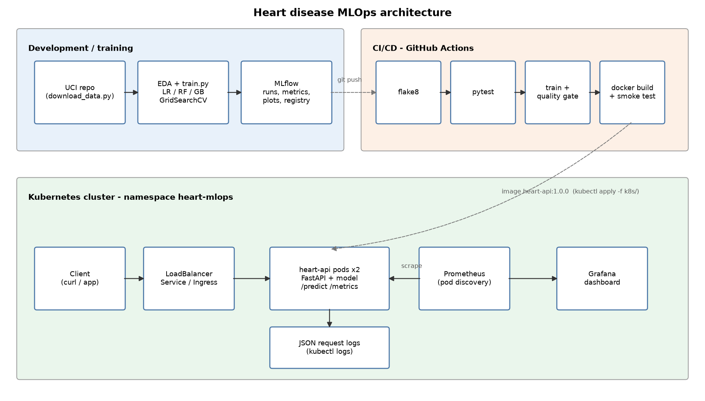

*Figure 1: System architecture.*

# 2. Setup and installation

```bash
git clone https://github.com/jangde-aboli/MLOPs_assignment_HeartML.git && cd MLOPs_assignment_HeartML
python -m venv .venv && source .venv/bin/activate      # Windows: .venv\Scripts\activate
pip install -r requirements.txt

python scripts/download_data.py     # raw + cleaned CSV
python -m heartml.eda               # figures -> reports/figures
python -m heartml.train             # MLflow runs + models/heart_model.joblib
pytest -v                           # 25 unit tests
uvicorn api.main:app --port 8000    # http://localhost:8000/docs
```

Every dependency is pinned in `requirements.txt`. The Docker image installs only the smaller
`requirements-serve.txt`, which leaves out MLflow, plotting and the test tools.

| Folder | Contents |
|---|---|
| `heartml/` | Reusable package: config, data, features, train, predict, eda |
| `api/` | FastAPI app and Pydantic schemas |
| `tests/` | Pytest unit tests (data, model, API) |
| `notebooks/` | 01 EDA, 02 training, 03 inference (they call the package) |
| `scripts/` | Data download, smoke/load test, K8s deploy, diagram/dashboard builders |
| `k8s/` | Deployment, Service, Ingress, Prometheus + Grafana manifests |
| `monitoring/` | Prometheus config, Grafana provisioning and dashboard JSON |
| `.github/workflows/` | CI/CD pipeline |
| `screenshots/` | Evidence used in this report |

# 3. Data acquisition and EDA

## 3.1 Acquisition

`scripts/download_data.py` downloads `processed.cleveland.data` from the UCI archive and
falls back to the UCI static CSV if that fails. The raw file has no header and uses `?` for
missing values. The cleaned output is `data/processed/heart_clean.csv`, with 303 rows,
13 features and the target.

## 3.2 Cleaning decisions

| Issue | Treatment | Reason |
|---|---|---|
| `?` tokens (4 in `ca`, 2 in `thal`) | Parsed as NaN; imputed **inside the pipeline** (most frequent value) | The API applies exactly the same imputation, so a request may leave `ca`/`thal` out |
| Target `num` takes values 0-4 | `target = num > 0` | The task is presence vs. absence; levels 1-4 are rare and noisy on their own |
| Zero blood pressure / cholesterol | Set to NaN, then median-imputed | Physiologically impossible (none in Cleveland, but the guard protects against other UCI subsets) |
| Duplicate rows | Dropped | None in Cleveland; the step is kept for robustness |

## 3.3 Findings

* **Class balance:** 164 without disease (54%) and 139 with disease (46%). This is close
  enough to balanced that no resampling is needed, and stratified splits keep the ratio.
* **Strongest signals** (|Pearson r| with the target): `thal` 0.53, `ca` 0.46,
  `exang` 0.43, `oldpeak` 0.43, `thalach` −0.42, `cp` 0.41. `chol` (0.09) and `fbs` (0.03)
  are almost uninformative on their own.
* The disease-rate plots show the categorical codes are **not ordinal** in effect. For
  example, chest-pain type 4 (asymptomatic) carries a 73% disease rate, while types 1-3
  sit around 20-30%. This is the main reason for one-hot encoding.
* Patients with disease have a clearly lower maximum heart rate (`thalach`) and higher ST
  depression (`oldpeak`).

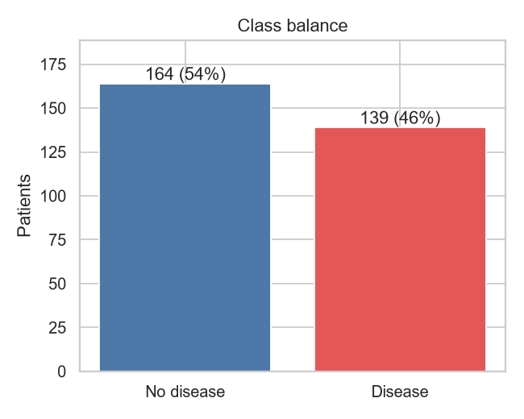{width=45%}

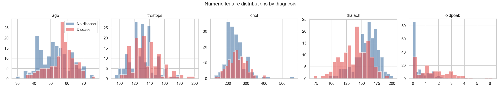

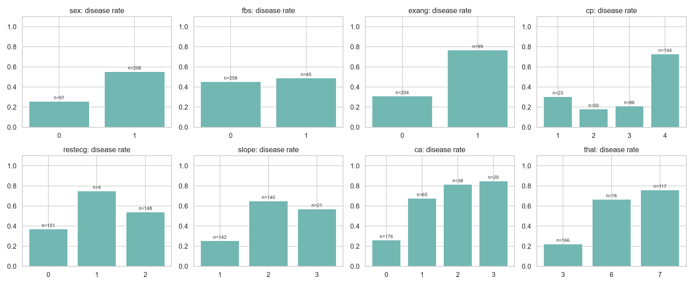

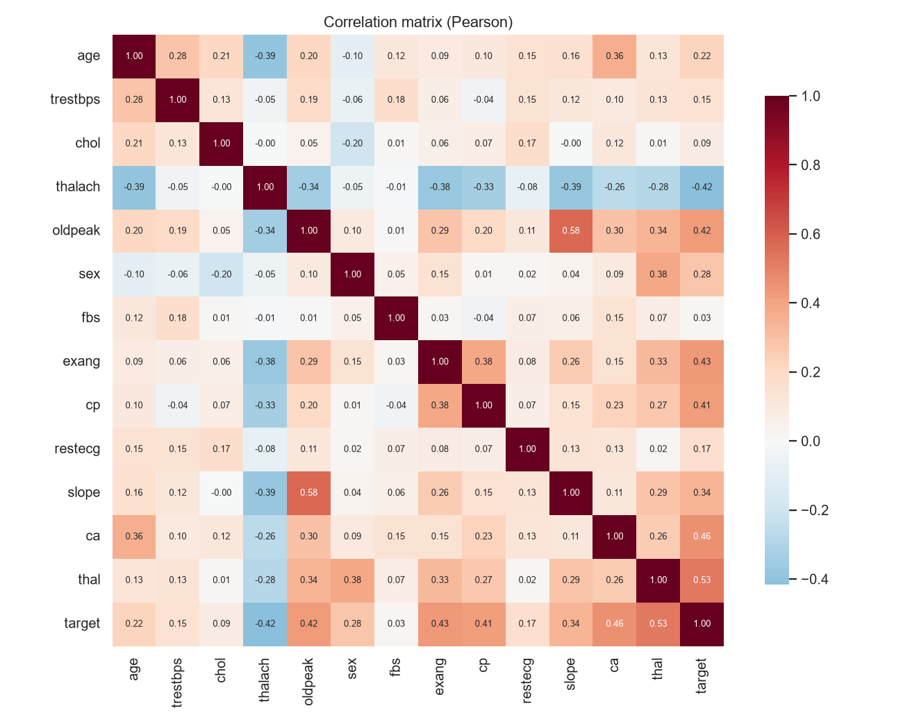{width=80%}

# 4. Feature engineering and model development

## 4.1 Preprocessing (`heartml/features.py`)

All preprocessing is a `ColumnTransformer` placed in front of the estimator in one
`Pipeline`. The saved artefact therefore takes **raw** feature values, and training and
serving cannot drift apart.

| Group | Columns | Steps |
|---|---|---|
| Continuous | age, trestbps, chol, thalach, oldpeak | median impute → `StandardScaler` |
| Binary | sex, fbs, exang | most-frequent impute (already 0/1) |
| Nominal | cp, restecg, slope, ca, thal | most-frequent impute → `OneHotEncoder(handle_unknown="ignore")` |

`handle_unknown="ignore"` means an unseen category code at inference produces an all-zero
one-hot vector instead of an error. The API schema already rejects out-of-range codes,
so this is a second line of defence.

## 4.2 Models and tuning

The data was split 80/20, stratified, with a fixed seed of 42. On the 80% training part,
each model family was tuned with `GridSearchCV` (stratified 5-fold, scored by ROC-AUC), and
the tuned configuration was then cross-validated again to collect accuracy, precision,
recall, F1 and ROC-AUC. The 20% test split was used **only** for the final report.

| Model | Grid searched | Combos | Best parameters |
|---|---|---|---|
| Logistic Regression (liblinear) | C ∈ {0.01, 0.1, 1, 10}, penalty ∈ {l1, l2} | 8 | C = 1, L2 |
| Random Forest | n_estimators {200, 400}, max_depth {None, 4, 8}, min_samples_leaf {1, 3, 5}, max_features {sqrt, 0.5} | 36 | 400 trees, depth 8, leaf 5, sqrt |
| Gradient Boosting | n_estimators {100, 200}, learning_rate {0.03, 0.1}, max_depth {2, 3}, subsample {0.8, 1.0} | 16 | 100 trees, lr 0.03, depth 2, subsample 0.8 |

Both tree models chose their **most regularised** settings (large leaves, shallow trees,
low learning rate). With only about 240 training rows, the extra flexibility of the
ensembles buys nothing.

## 4.3 Results

| Model | CV ROC-AUC (± sd) | CV acc. | CV prec. | CV recall | Test acc. | Test prec. | Test recall | Test ROC-AUC |
|---|---|---|---|---|---|---|---|---|
| **Logistic Regression** | **0.905 ± 0.015** | **0.847** | **0.877** | **0.783** | 0.885 | 0.839 | 0.929 | **0.969** |
| Random Forest | 0.899 ± 0.025 | 0.830 | 0.844 | 0.783 | 0.885 | 0.839 | 0.929 | 0.949 |
| Gradient Boosting | 0.884 ± 0.030 | 0.818 | 0.846 | 0.756 | 0.902 | 0.867 | 0.929 | 0.960 |

**Selection.** The model is chosen on **cross-validated ROC-AUC**, not test accuracy. With
61 test rows a single patient moves accuracy by 1.6 points, so Gradient Boosting's higher
test accuracy (0.902 against 0.885) amounts to one patient. Logistic Regression has the best
mean CV ROC-AUC, the lowest fold-to-fold variance, and the best test ROC-AUC. It is also
interpretable: its coefficients are shown below.

The selected configuration is **refit on all 303 rows** before it is saved.

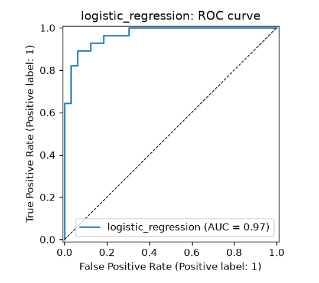{width=45%}
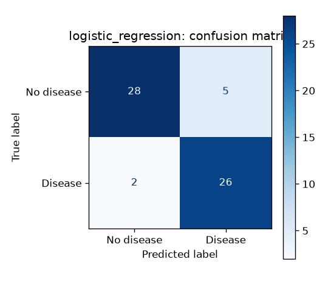{width=45%}

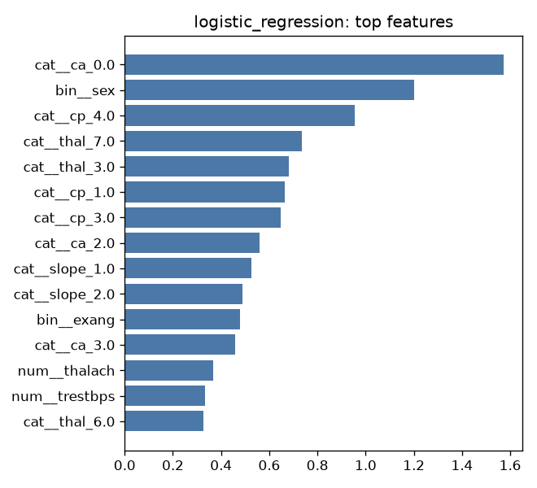{width=60%}

# 5. Experiment tracking (MLflow)

`heartml/train.py` stores results in an MLflow tracking store, a local SQLite database
(`mlflow.db`) by default or any server set through `MLFLOW_TRACKING_URI`. Experiment:
`heart-disease-classification`.

Each candidate run logs:

* **Parameters:** best hyperparameters, `test_size`, `cv_folds`, train/test sizes, grid size
* **Metrics:** mean and standard deviation of CV accuracy, precision, recall, F1 and
  ROC-AUC, plus the five test-set metrics
* **Artifacts:** confusion matrix, ROC curve, feature-importance plot, and the full
  `GridSearchCV` results table as CSV
* **Model:** an MLflow sklearn model with an inferred signature and an input example
* **Tags:** model family, quick mode

A final run (`final_logistic_regression`) logs the refit pipeline, the joblib file and
`model_meta.json`, and registers it as **`heart-disease-classifier`** in the model registry.

To view the runs: `mlflow ui --backend-store-uri sqlite:///mlflow.db` → <http://127.0.0.1:5000>.

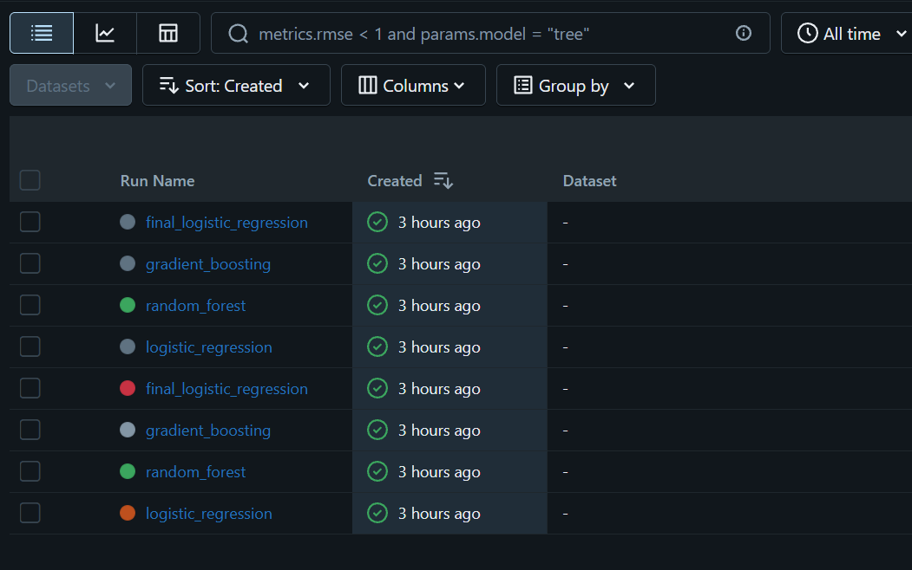

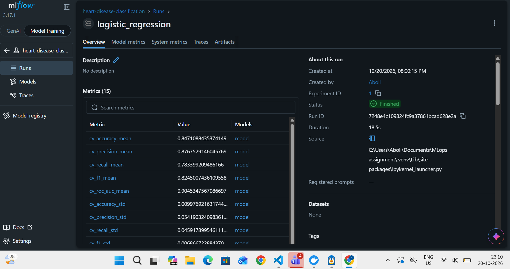

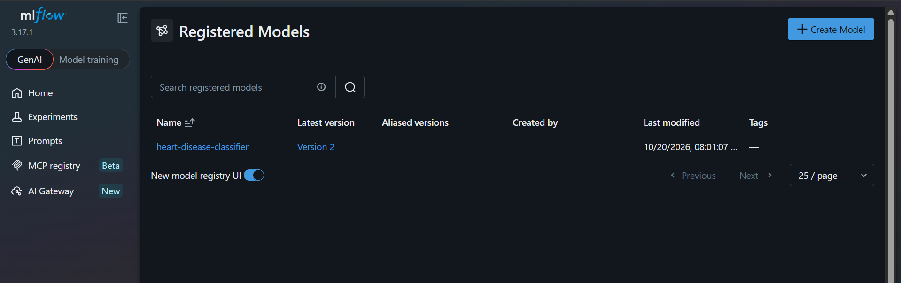

# 6. Packaging and reproducibility

* **Model format:** `models/heart_model.joblib` holds the complete preprocessing and model
  `Pipeline`. `model_meta.json` records the model name, MLflow run ID, parameters, metrics,
  feature order, sklearn version and training timestamp. The same model is also stored as an
  MLflow model (skops serialisation) in the registry.
* **Determinism:** a single `RANDOM_STATE = 42` drives the split, the CV folds and the
  models, so re-running training gives the same metrics.
* **Environment:** `requirements.txt` pins all versions. The image uses Python 3.12 and
  `requirements-serve.txt`.
* **Single source of truth:** the notebooks, CI and the API all import the same `heartml`
  package, so no logic is copied into notebooks.

# 7. CI/CD pipeline and automated testing

## 7.1 Unit tests (`tests/`, 25 tests)

| File | Covers |
|---|---|
| `test_data.py` | Binary target creation, duplicate removal, impossible values → NaN, NaNs kept for the pipeline, no mutation of input, `?` parsing, X/y split |
| `test_model.py` | No NaNs after preprocessing, scaling, one-hot width, unseen categories, probability output, metric ranges, search space, confidence = P(predicted class), missing optional fields, risk bands, joblib round-trip |
| `test_api.py` | `/health`, `/predict` (prediction, confidence, request ID header), 422 on invalid or extra fields, batch endpoint, `/metrics` content, `/model-info` |

The API tests train a tiny model on synthetic data inside a fixture, so they run on a fresh
clone without the real dataset or a trained model.

## 7.2 GitHub Actions (`.github/workflows/ci.yml`)

The pipeline runs on every push to `main`, on every pull request, and on manual dispatch.
Its jobs run in order; any failure stops the jobs after it.

| Job | Steps | Artifacts |
|---|---|---|
| **lint** | `flake8` over the package, API, tests and scripts | n/a |
| **test** | `pytest -v --junitxml` | `test-results` (JUnit XML) |
| **train** | download data → EDA → full training → **quality gate** (fail if CV ROC-AUC < 0.85) | `model`, `training-reports` (figures, comparison CSV, logs, clean data), `mlflow-tracking` |
| **docker** | download the model artifact → `docker build` → `docker run` → `scripts/smoke_test.py` | `container-logs` |

The training step runs under `shell: bash`, which turns on `pipefail`, so a crash is not
hidden by the `| tee` that saves the log. The smoke test exits non-zero on any failed check,
including a check that invalid input is rejected with 422.

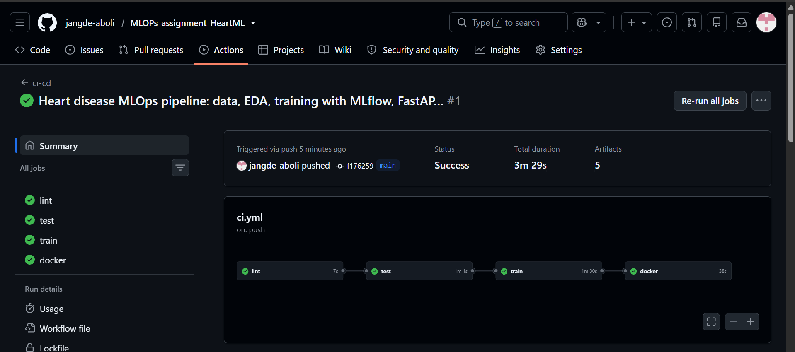

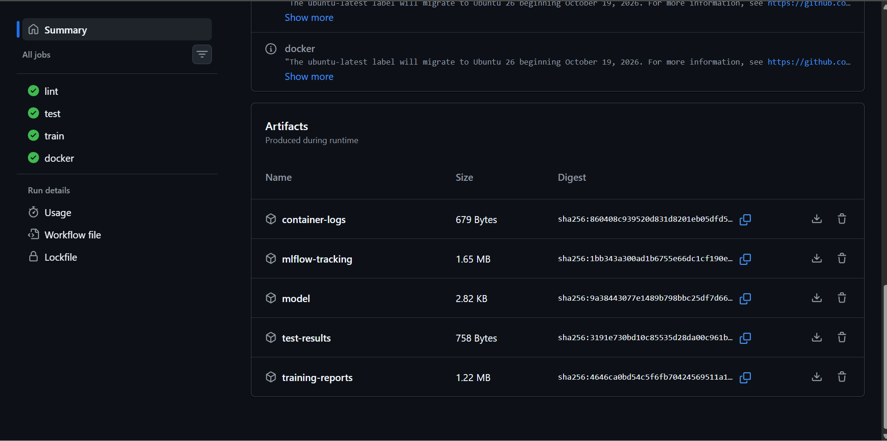

# 8. Containerisation

The `Dockerfile` builds from `python:3.12-slim`, installs only the serving dependencies,
copies the package, the API and the trained model, runs as an unprivileged user (UID 10001),
and declares a `HEALTHCHECK` against `/health`. It runs a single uvicorn worker per
container because `prometheus_client` counters are per process; scaling happens through
Kubernetes replicas.

**API contract**

| Method | Path | Purpose |
|---|---|---|
| GET | `/health` | Liveness/readiness; reports whether the model is loaded |
| GET | `/model-info` | Contents of `model_meta.json` |
| POST | `/predict` | One patient → `prediction`, `label`, `probability_disease`, `confidence`, `risk_level`, `request_id` |
| POST | `/predict/batch` | Up to 100 patients |
| GET | `/metrics` | Prometheus exposition format |

The Pydantic schema validates value ranges and the allowed category codes (for example
`cp ∈ {1, 2, 3, 4}`) and rejects unknown fields, so bad input gets a clear 422 instead of a
silent wrong prediction. *Confidence* is the probability of the predicted class.
*risk_level* is low below 0.3, moderate from 0.3 to 0.6, and high at 0.6 or above.

```bash
docker build -t heart-api:1.0.0 .
docker run -p 8000:8000 heart-api:1.0.0
curl -X POST localhost:8000/predict -H "Content-Type: application/json" -d @samples/patient.json
{"prediction":1,"label":"heart disease","probability_disease":0.8793,"confidence":0.8793,
 "risk_level":"high","model_name":"logistic_regression","request_id":"c764470a9ad4"}
```

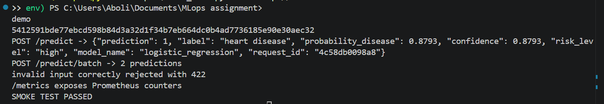

# 9. Production deployment (Kubernetes)

`k8s/api.yaml` defines:

* **Namespace** `heart-mlops`
* **Deployment** with 2 replicas, a rolling update (maxUnavailable 0), CPU/memory requests
  and limits, readiness and liveness probes on `/health`, a non-root security context, and
  `prometheus.io/*` scrape annotations
* **Service** of type `LoadBalancer` (port 80 → 8000). Docker Desktop maps it to
  `localhost`; on Minikube it is reached through `minikube tunnel`
* **Ingress** (nginx) for host `heart-api.local`

`scripts/deploy_k8s.sh` builds the image (inside Minikube's Docker daemon when the current
context is Minikube), applies the manifests, creates the Grafana dashboard ConfigMap, and
waits for the rollout.

```bash
bash scripts/deploy_k8s.sh
kubectl -n heart-mlops get pods,svc,ingress
python scripts/smoke_test.py --url http://127.0.0.1
```

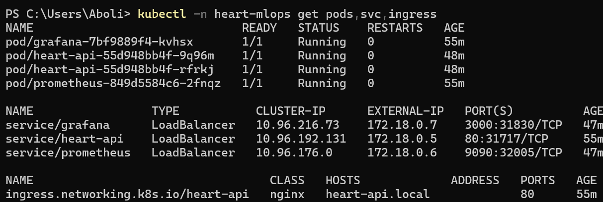

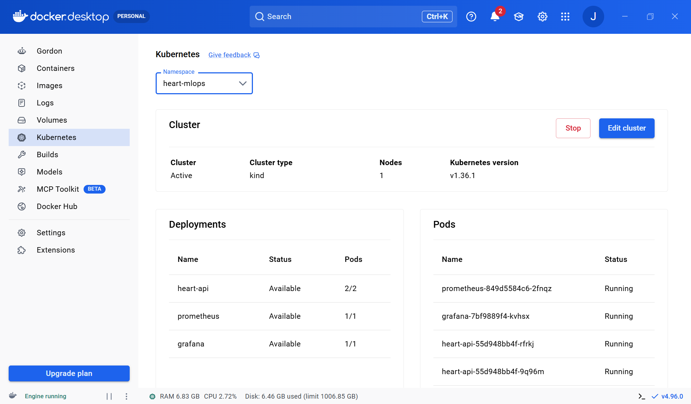

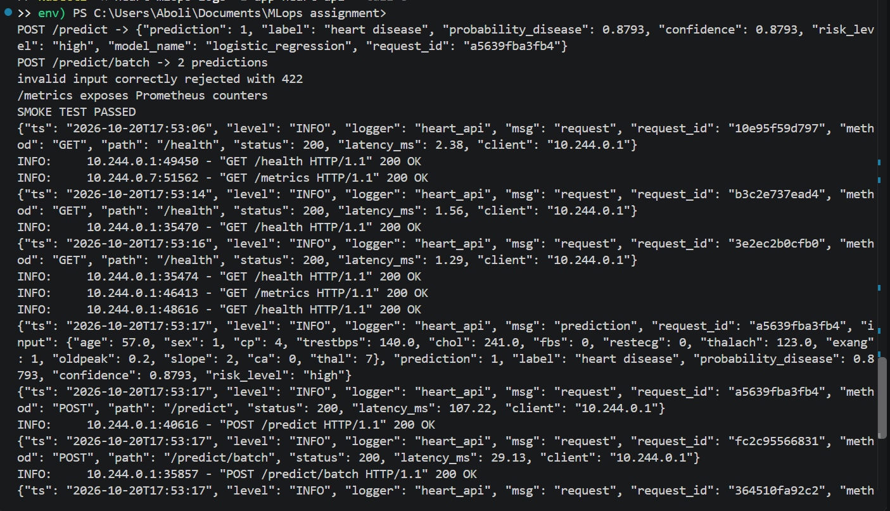

# 10. Monitoring and logging

**Logging.** Middleware writes one JSON line per request with the request ID, method, path,
status, latency and client. Each prediction is logged with its input and output. The request
ID comes from the `X-Request-ID` header when the caller sends one, otherwise it is
generated, and it is returned to the caller so a single request can be traced. Logs go to
stdout (`kubectl logs`), and to a file when `LOG_FILE` is set.

**Metrics** (`/metrics`):

| Metric | Type | Use |
|---|---|---|
| `heart_api_requests_total{method,endpoint,status}` | Counter | Throughput, error rate |
| `heart_api_request_latency_seconds{endpoint}` | Histogram | p50/p95 latency |
| `heart_api_predictions_total{label}` | Counter | Class mix, a simple drift signal |
| `heart_api_disease_probability` | Histogram | Distribution of predicted risk |
| `heart_api_model_loaded` | Gauge | Model availability |

Metric labels use the route template rather than the raw path, which keeps label
cardinality bounded.

**Stack.** Prometheus discovers the API pods through their annotations (with RBAC scoped to
the namespace). Grafana is provisioned with the Prometheus datasource and a nine-panel
dashboard: model-loaded status, total predictions, disease share, error rate, request rate,
p50/p95 latency, predictions by class, the probability distribution, and responses by
status. Running `scripts/smoke_test.py --load 300` generates traffic, including some invalid
requests, so the error-rate panel has data. For local work, `docker compose up` starts the
same stack without Kubernetes.

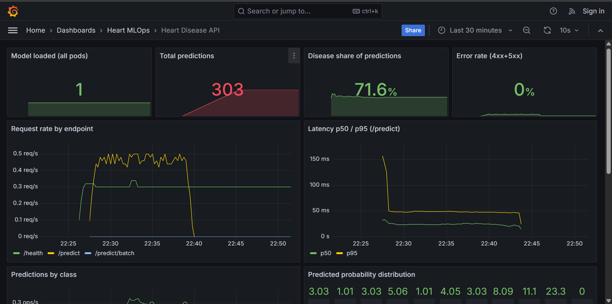

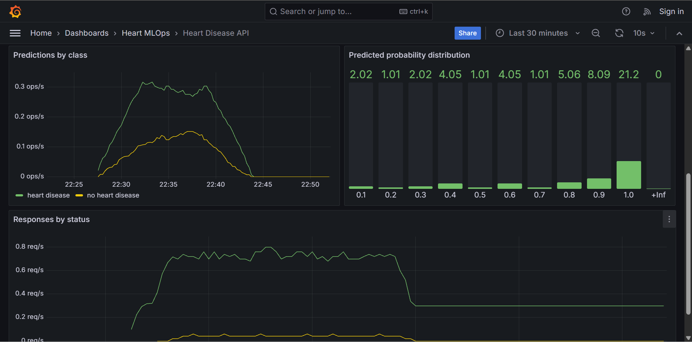

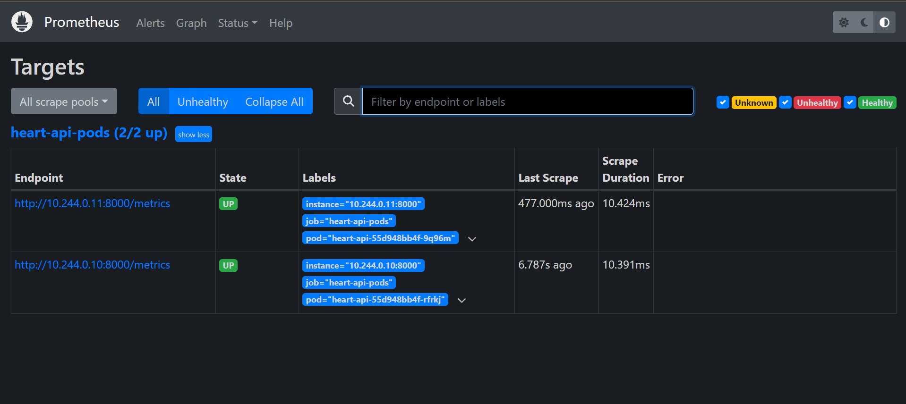


# 11. Limitations and next steps

* **Small data:** 303 patients from a single hospital. The metrics carry wide uncertainty
  (CV standard deviation of about 0.015-0.03 in ROC-AUC), and the model should be validated
  on the Hungarian, Swiss and VA subsets before any wider use.
* **Fixed threshold of 0.5:** in a screening setting, missing a case costs more than a false
  alarm. The threshold could be chosen for a target recall and stored in `model_meta.json`.
* **Image registry:** the image is built locally. The next step is to push to GHCR from CI
  and deploy with `kubectl set image`, or with Argo CD, for continuous delivery.
* **Drift monitoring:** the class-mix and probability histograms are a first signal. A fuller
  setup would compare live feature distributions against the training data, for example
  with Evidently.

# 12. Deliverables checklist

| Requirement | Location |
|---|---|
| Download script + cleaned data | `scripts/download_data.py`, `data/processed/heart_clean.csv` |
| EDA / training / inference notebooks | `notebooks/01_eda.ipynb`, `02_training.ipynb`, `03_inference.ipynb` |
| ≥ 2 models, CV, metrics | `heartml/train.py`, `reports/model_comparison.csv` |
| MLflow tracking | `mlflow.db`, Section 5 |
| Saved model + reproducible pipeline | `models/`, `heartml/features.py`, `requirements.txt` |
| Unit tests | `tests/` |
| CI workflow | `.github/workflows/ci.yml` |
| Dockerfile + `/predict` | `Dockerfile`, `api/main.py` |
| K8s manifests (LoadBalancer + Ingress) | `k8s/api.yaml` |
| Monitoring | `k8s/monitoring.yaml`, `monitoring/`, `docker-compose.yml` |
| Screenshots | `screenshots/` |
| Access instructions | `README.md` §3-5 |
